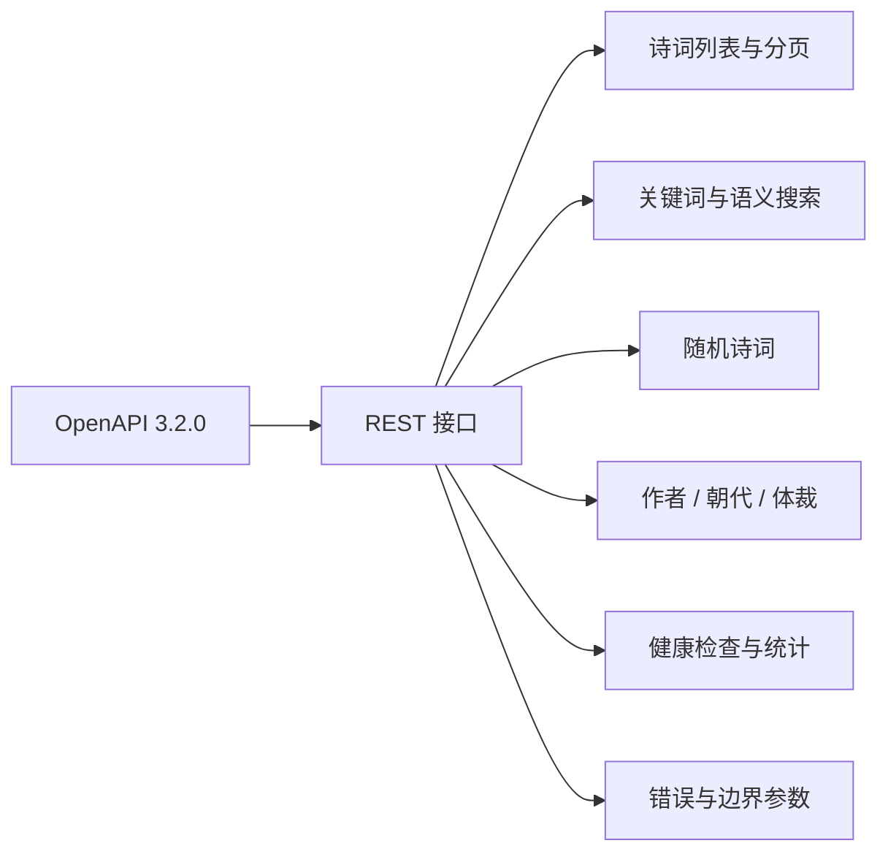

<div align="center">

# Chinese Poetry API Docs

**中国古诗词 API 的可导入接口规范、调用示例与 Python 自动化测试资产**

[](./openapi.yaml)
[](./api-tests/reports/junit.xml)
[](./api-tests/README.md)
[](https://github.com/palemoky/chinese-poetry-api/blob/main/LICENSE)

</div>

## 这是什么

这是一个围绕 [Chinese Poetry API](https://github.com/palemoky/chinese-poetry-api) 整理的接口交付仓库，面向接口消费者、测试人员和维护者，提供：

- 可导入 Postman、Apifox、Swagger Editor 的 OpenAPI 规范
- 按业务场景整理的 `curl` 调用示例
- 32 条可执行的 REST API 测试用例
- 基于 `pytest + requests` 的 Python 自动化测试项目
- HTML、Markdown、Excel 和 JUnit 测试报告

## 先看什么

| 目标 | 文件 |
| --- | --- |
| 浏览完整接口 | [交互式 REST API 文档](./rest-api.html) |
| 导入工具或生成客户端 | [OpenAPI 规范](./openapi.yaml) |
| 复制调用命令 | [REST API 示例](./rest-api-examples.md) |
| 评审测试范围 | [测试用例文档](./rest-api-test-cases.md) · [Excel 版本](./rest-api-test-cases.xlsx) |
| 运行自动化测试 | [api-tests/README.md](./api-tests/README.md) |

## API 覆盖范围



服务默认地址：`http://localhost:1279`

```bash
curl "http://localhost:1279/api/v1/health"
curl "http://localhost:1279/api/v1/poems/search?q=静夜思"
curl "http://localhost:1279/api/v1/poems/random?author=李白"
```

REST 基础路径为 `/api/v1`，支持简体 `zh-Hans`（默认）和繁体 `zh-Hant`。分页、游标、作者/朝代/体裁过滤、统一错误响应和限流行为均已写入 OpenAPI 规范。

## 运行自动化测试

要求本地 API 服务已启动。

```powershell
cd api-tests
python -m pip install -r requirements.txt
pytest
```

当前测试结果：`36 passed, 1 skipped`。跳过项是语义检索未配置向量文件和 embedding API 时的预期降级场景；测试会验证服务返回 `503`，不会将其误判为接口故障。

切换被测服务地址：

```powershell
$env:POETRY_API_BASE_URL = "http://localhost:1279"
pytest -m smoke
```

测试项目采用成熟框架组合：

- `pytest`：fixture、参数化、测试标记和报告
- `requests`：HTTP 请求客户端
- `openpyxl`：测试用例 Excel 生成
- 请求层统一处理超时与 `429` 限流等待重试

## 仓库结构

```text
.
├── openapi.yaml                 # OpenAPI 3.2.0 规范
├── rest-api.html                # 交互式 API 文档
├── rest-api-examples.md         # curl 调用示例
├── rest-api-test-cases.md       # 测试用例说明
├── rest-api-test-cases.xlsx     # Excel 测试用例
└── api-tests/
    ├── api/                     # 请求封装
    ├── config/                  # 环境配置
    ├── data/                    # 机器可读用例
    ├── tests/                   # pytest 测试
    └── reports/                 # JUnit 报告
```

## 重要限制

- 作者、朝代和体裁的 ID 可能随数据发布变化，稳定引用应优先使用名称。
- `/api/v1/poems/semantic` 只有在服务端启用向量文件和 embedding API 后才可用。
- 服务按客户端 IP 限流；批量执行测试时请保留请求间隔，不要关闭限流验证。
- 本仓库保存文档、测试数据和测试代码，不包含原始 Go 服务源码或 Docker 数据卷。

## 相关链接

- [上游项目](https://github.com/palemoky/chinese-poetry-api)
- [在线服务](https://poetry.palemoky.com)
- [OpenAPI 文件](./openapi.yaml)
- [JUnit 报告](./api-tests/reports/junit.xml)
